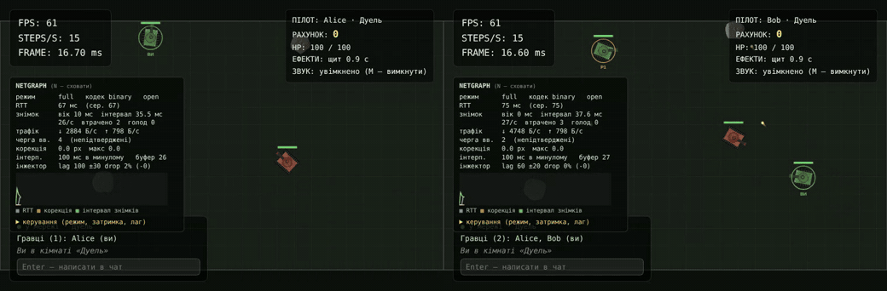
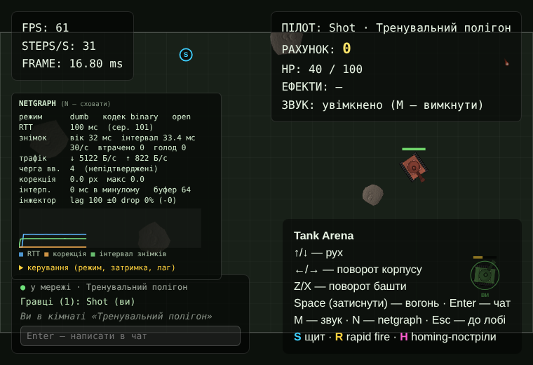
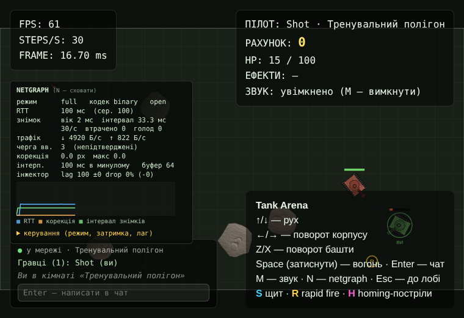
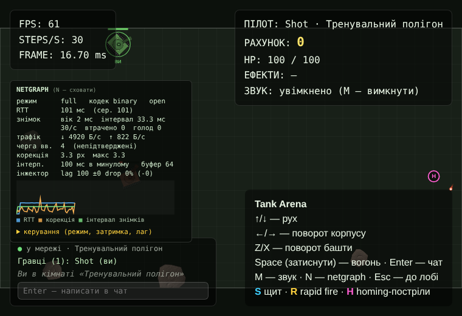

# Tank Arena — Lab 05

Лабораторна 05: **мережева гра — авторитетний сервер, передбачення, звірка, інтерполяція і бінарний протокол**.

Гра більше не рахується в браузері. Двоє (до восьми) гравців у кімнаті надсилають серверу **ввід** (газ, поворот, башта, вогонь + номер `seq`), а **світ рахує тільки сервер** і 30 разів на секунду розсилає знімки. Клієнт малює їх і при цьому не здається на милість RTT: власний корабель рухається одразу (передбачення), а чужі показуються трохи «в минулому» (інтерполяція).



Попередні лаби: [lab-01](docs/lab-01.md) · [lab-02](docs/lab-02.md) · [lab-03](docs/lab-03.md) · [lab-04](docs/lab-04.md). Специфікація формату: [docs/protocol-v1.md](docs/protocol-v1.md).

## Запуск

```bash
npm install
npm start                    # build клієнта + сервер на http://127.0.0.1:3000

# або розробка: два процеси (Vite :5173 проксує /api, /health і /ws на сервер :3000)
npm run dev:server
npm run dev:client
```

`npm test` — 223 тести (51 shared, 85 клієнт, 87 сервер), `npm run lint`.

**Перевірка «два вікна»:** відкрийте сторінку у двох вікнах → обидва в кімнаті «Дуель» (або будь-якій) → стріляйте й їдьте; у кожного внизу-ліворуч — **netgraph** (`N` — сховати, «керування» розкриває повзунки).

Умови мережі задаються в URL і вживу повзунками в netgraph:

| Параметр                    | Значення                                                                        |
| --------------------------- | ------------------------------------------------------------------------------- |
| `?lag=100`                  | +100 мс до RTT (по 50 на кожен напрямок)                                        |
| `&jitter=30`                | кожен пакет ±30 мс (порядок пакетів зберігається, як у TCP)                     |
| `&drop=2`                   | 2% пакетів губиться на кожному напрямку                                         |
| `&mode=dumb\|predict\|full` | M1 тупий клієнт / M2 передбачення / M3 + інтерполяція (за замовчуванням `full`) |
| `&delay=100`                | затримка інтерполяції, мс (змінюється й вживу)                                  |
| `&codec=json`               | JSON замість бінарного протоколу                                                |
| `&break=random`             | експеримент: `Math.random()` у фізиці передбачення                              |

Інжектор працює **на клієнті, на обох шляхах** (ввід назовні, знімки досередини), і зачіпає лише ігровий трафік; чат і join йдуть без затримки. У консолі: `__net.lag.configure({ lag: 150 })`, `__net.stats()`.

## Структура

```text
shared/                       та сама симуляція в браузері й у Node (без DOM, без node:*)
  src/sim/                    World, Entity, Ship, Game (multi-player), колізії — з лаб 1–2
  src/math.js                 власні sin/cos/atan2/exp/hypot (див. «Баг детермінізму»)
  src/rng.js                  mulberry32: насіння приходить із сервера
  src/hash.js, scenario.js    FNV-1a хеш стану + скриптований сценарій
  src/protocol/               константи, buildSnapshot(), IDLE_INPUT, seqNewer()
  src/codec/                  binary.js (DataView), json.js, index.js (getCodec)
  test/                       sim, determinism (golden-хеші), math, codec (round-trip, fuzz)
  tools/, experiments/        hash-chrome.mjs, bench-protocol.mjs, endianness.mjs, math-divergence.mjs
server/
  src/match.js                Match: тікер 30 Гц, черга вводу, знімки, статистика
  src/matches.js              кімната відкрилась → матч стартував; спорожніла → зупинено
  src/ws.js, protocol.js      бінарні кадри після join, input/ping, rate limit
  experiments/tick-timer.mjs  setInterval проти абсолютної цілі
client/
  src/net/net-game.js         ввід 30 Гц, seq, передбачення, звірка, буфер, статистика
  src/net/predictor.js        передбачення + reconcile + згладжування
  src/net/snapshot-buffer.js  годинник за тіками, вибірка пари знімків
  src/net/interpolate.js      інтерполяція з обгортанням арени, поява/зникнення
  src/net/lag.js              інжектор lag/jitter/drop
  src/netgraph.js             панель RTT / вік знімка / байти / черга / корекція
  tools/measure-delay.mjs     вибір затримки інтерполяції
```

## Що змінилось порівняно з лабою 4

- **`shared/`** — симуляція переїхала з `client/src/sim` (git зберіг історію). Жодних `Math.random`, `Date.now`, `performance.now`, `Math.sin/cos/atan2/pow/exp` у `shared/src/sim` — це забороняє ESLint.
- **Крок 1/30 с.** Клієнт теж крутить симуляцію з `dt = 1/30` (раніше 1/60): один ввід = один крок.
- **Арена 1280×720 фіксована** (вона частина симуляції на сервері); клієнт вписує її у вікно.
- **Рахунок, HP, ефекти, звуки** приходять зі знімків. Влучання клієнт не рахує.
- **Протокол v2:** `join` має `codec`, `welcome` — `seed` і `tickRate`, `roster` — `slot`. Бінарні кадри дозволені після `join`; rate limit за замовчуванням 20 → 90 повідомлень/с (30 вводів/с + ping).

## M1 — авторитетний сервер і «тупий» клієнт

`server/src/match.js`. Один `Match` на кімнату: стартує, коли зайшов перший гравець, зупиняється, коли вийшов останній.

- **Тікер 30 Гц з абсолютною ціллю.** Крок `n` має відбутись у `start + n·33.33 мс`; `setTimeout` лише будить нас, а затримку до наступної цілі рахуємо від `start`. Затримався тік — наступний коротший, похибка не накопичується.
- **Перевантаження.** Якщо після кроку ми позаду цілі, виконуємо до 3 кроків поспіль (catch-up). Якщо все ще позаду більш ніж на інтервал — **resync**: ціль зсувається на «зараз» (`resyncs++`). Без цього кожен крок дорожчий за інтервал вів би до «спіралі смерті» — тест `Match: перевантажений крок`.
- **Ввід.** Кожен ввід має `seq`. Сервер відкидає дублікати (надлишковість 3 вводи в пакеті) і старі `seq`, тримає чергу ≤ 10 (спід-хак: 1000 вводів за раз не прискорить корабель), споживає **один ввід за тік**; черга довша за 3 — пропускає найстаріші (затримка керування не накопичується); порожня — лишається попередній ввід. Значення вводів перевіряються (`−1/0/1`, булевий `fire`, u32 `seq`), сміття → закриття 4001.
- **Знімок** кодується один раз на кодек і розсилається всім; повільному клієнту (за політикою з лаби 4: `bufferedAmount`) знімок пропускається — він і так повний, а гравець наздожене наступним.
- **`/api/stats`** (і `/health`): на матч — `tickMs {avg,max}` (скільки коштує крок), `jitterMs {avg,max}` (на скільки таймер спрацював пізніше цілі), `overruns`, `resyncs`, `lastSnapshotBytes`, `bytesOut`, `encodeMicros`, `skippedInputs`, `repeatedInputs`, `droppedInputs`.
- **Тупий клієнт** (`?mode=dumb`): малює лише останній знімок, навіть власний корабель. Корабель рухається **після** знімка.

## M2 — передбачення і звірка

`client/src/net/predictor.js`. Власний корабель симулюється тим самим класом `Ship` і `World` із `shared/` — у мінімальному світі, де є лише він.

1. Кожен крок клієнта: `step(input)` — корабель рухається **одразу**, ввід кладеться в `pending`, пакет із 3 останніх вводів іде на сервер.
2. Прийшов знімок: корабель **скидається у стан сервера** (авторитет), підтверджені вводи (`seq ≤ ack`) викидаються, решта **перегравається** поверх.
3. Різниця «було → стало» — корекція (її розмір у netgraph). Вона не показується стрибком, а додається до `offset`, який згасає експоненційно (`τ = 33 мс`, за ~100 мс — 95%). Розбіжність понад 100 px (респаун, телепорт) показується одразу.
4. **Власні кулі** з'являються одразу (передбачені, пряма траєкторія) і зникають, коли знімок після `ack` вже не містить кулі з тим самим `tag`. Це свідоме відхилення від «замінити серверною за id»: підміна позицією зі знімка відкотила б кулю назад на RTT×560 px/с. Ціна — куля, що влучила, може пролетіти ~RTT×560 px «наскрізь», доки прийде підтвердження. Homing-кулі лише серверні (їхня траєкторія залежить від цілей, яких клієнт не знає).

### Netgraph до і після

Відгук керування (від натискання `↑` до першого руху корабля на екрані; 5 запусків у Chromium, `lag=100`, RTT ≈ 100 мс):

| режим                          | відгук, мс                         |
| ------------------------------ | ---------------------------------- |
| M1 тупий клієнт                | 127, 129, 196, 131, 129 → **≈142** |
| M2 передбачення                | 47, 62, 47, 47, 47 → **≈50**       |
| M3 передбачення + інтерполяція | 64, 64, 64, 64, 47 → **≈60**       |

Тупий клієнт реагує за RTT + крок + черга сервера + кадр; передбачений — за наступний крок клієнта (0–33 мс) + кадр.

| Тупий клієнт, lag 100                                                 | Передбачення, lag 100                                                     |
| --------------------------------------------------------------------- | ------------------------------------------------------------------------- |
|  |  |

З передбаченням корекція в нормі — соті частки пікселя (≈0.01 px, залишок — квантування швидкості `1/8 px/с` і таймерів у знімку). Окремо `lag=100&jitter=30&drop=2` ([скриншот](docs/screenshots/netgraph-jitter-drop.png)): корекції до ≈6 px — це не помилка симуляції, а **втрачені вводи**: сервер повторив попередній ввід там, де клієнт їхав інакше.

### Експеримент: `Math.random()` у фізиці

`?break=random` ([dev/determinism-break.js](client/src/dev/determinism-break.js)) додає `Math.random()` до швидкості корабля **лише в клієнтській копії** симуляції. Сервер рахує без шуму, клієнт — із шумом, тож після кожного знімка «звірка» знаходить розбіжність:



Корекція виросла з ≈0.01 px до середніх ≈2 px і піків 4.7 px, а на графіку помаранчева лінія постійно «рве» — корабель на екрані тремтить. Той самий ефект відтворює unit-тест (`клієнт/tests/netcode.test.js`: «Math.random у фізиці клієнта ⇒ корекції виростають на порядки»). Прапорець прибрано з URL — і все повернулось до норми. Чим більший RTT, тим більше вводів перегравається поверх кожного знімка і тим більше накопичується шуму.

## M3 — чужі об'єкти в минулому, поява й зникнення, власні кулі

- **Годинник за тіками.** Час знімка = `tick · 33.33 мс`. Зсув клієнт↔сервер — **мінімум** `arrival − tickTime` за ~5 с (найшвидший пакет майже не затримався; середнє «пливло» б із jitter). Малюємо момент `serverNow − delay`.
- **Інтерполяція** між двома знімками навколо цього моменту: позиції (з обгортанням арени — шлях через край найкоротший), кути, башта. Сутність, що з'явилась між знімками, не малюється, доки час не дійшов до її знімка; що зникла — малюється в останньому стані, доки час не перейшов далі. Подія (вибух, звук) показується в момент, коли до неї дійшов render time, а не при прийомі.
- **Голод** (render time пішов за останній знімок): тримаємо останній, не екстраполюємо; лічильник `голод` у netgraph.
- **Затримка регулюється вживу** (повзунок у netgraph, `?delay=`), і показується як `інтерп. N мс в минулому`.
- Власний корабель і власні кулі в `full` — з передбачення, **не** з буфера.

### Вибір затримки інтерполяції: 100 мс

Лаба радить ≈2 інтервали знімків (66 мс). Я виміряв, а не вгадав (`client/tools/measure-delay.mjs`: симуляція мережі з RTT 100, шістдесят секунд, 60 кадрів/с; комірка — «кадри голоду» / «кадри інтерполяції через пропущений знімок»):

| сценарій                 | 33 мс        | 66 мс        | **100 мс**      | 133 мс      | 166 мс      |
| ------------------------ | ------------ | ------------ | --------------- | ----------- | ----------- |
| ідеальна мережа          | 27.6% / 0    | 0 / 0        | 0 / 0           | 0 / 0       | 0 / 0       |
| jitter ±30 мс            | 68.1% / 0    | 11.8% / 0    | **0 / 0**       | 0 / 0       | 0 / 0       |
| jitter ±30 мс, втрати 2% | 67.2% / 0.3% | 11.9% / 1.2% | **0.1% / 2.0%** | 0 / 2.1%    | 0 / 2.1%    |
| jitter ±60 мс, втрати 5% | 94.4% / 0.4% | 69.4% / 2.2% | 31.5% / 5.2%    | 5.7% / 8.0% | 0.2% / 9.4% |

66 мс вистачає лише ідеальній мережі: на jitter ±30 мс у 12% кадрів чужі кораблі завмирають. Тому **за замовчуванням 100 мс (3 інтервали)**: на ±30 мс і 2% втрат голоду ≈0, а кожні 33 мс затримки понад це — це ще 33 мс «минулого» (стріляти по цілі доводиться з випередженням). На ±60 мс / 5% потрібно ≥133 мс — повзунок для цього і є.

## M4 — бінарний протокол

`shared/src/codec/binary.js`, формат — [docs/protocol-v1.md](docs/protocol-v1.md). `DataView`, little-endian явно, байт версії, кут `Int16`, швидкості `Int16·8`, таймери `Uint8`, довжина кожного кадру перевіряється до читання. JSON лишається за `?codec=json`.

**Тести:** round-trip усіх повідомлень у межах квантування (позиція 1e-3, швидкість 1/16, кут 1e-4 по всьому колу, hp точно), порожній світ, зрізані й задовгі кадри, чужа версія/тип, мусорні `flags`, ввід з `throttle=9`, **fuzz** (2000 випадкових кадрів: єдиний допустимий виняток — `CodecError`).

### JSON проти binary: 4 гравці, 30 Гц

Реальний матч (`shared/tools/bench-protocol.mjs`: 4 гравці, 2 вороги, 8 астероїдів, 1800 знімків; у середньому ≈21 сутність у знімку; Node 22). «Вгору» — пакет із 3 вводів на крок.

| формат | байт/знімок (сер. / макс.) | ↓ КБ/с на клієнта | ↑ КБ/с з клієнта | encode+decode, мкс |
| ------ | -------------------------- | ----------------- | ---------------- | ------------------ |
| json   | 3508 / 4703                | 102.78            | 6.33             | 48.0 (26.2 + 21.7) |
| binary | 434 / 586                  | 12.71             | 0.79             | 22.6 (16.0 + 6.5)  |

Binary у **8.1×** менший; знімок із 8 кораблів — 208 Б проти 1400 Б. JSON тут «чесний»: `JSON.stringify` без округлення, тож числа на кшталт `620.1949786096811` — саме так вони й їхали б у наївній версії. Для 8 гравців ↓ у JSON ≈ 100+ КБ/с, у binary ≈ 13 КБ/с.

## «Prove it» — експерименти

1. **Float32 і порядок байтів** (`node shared/experiments/endianness.mjs`): `1.5` як `Float32` — `00 00 c0 3f` (LE) проти `3f c0 00 00` (BE).
2. **`Uint16Array([1,0,0,1])`** лежить у пам'яті як `01 00 00 00 00 00 01 00` — порядок байтів **процесора**, а не мережі. Ті самі 4 байти `[1,0,0,1]` через `DataView`: LE → `1, 256`, BE → `256, 1`; `DataView` без аргументу читає **big-endian**.
3. **Знімок із 8 кораблів:** JSON 1400 Б, `DataView` 208 Б.
4. **`setInterval(33)` проти абсолютної цілі, 5 с** (`node server/experiments/tick-timer.mjs`, Node 22.22):

   |                      | тіків           | інтервал        | дрейф за 5 с |
   | -------------------- | --------------- | --------------- | ------------ |
   | `setInterval(33)`    | 151 (ідеал 150) | 33.21 ± 0.17 мс | **−19 мс**   |
   | `setTimeout` до цілі | 151 (ідеал 150) | 33.33 ± 0.42 мс | **0 мс**     |

   З навантаженням 5–25 мс на тік (`--busy`) — те саме: `−17` проти `−1` мс. Чесний висновок: у Node `setInterval` сам по собі не «накопичує запізнення» так сильно, як пише теорія, і його джиттер навіть трохи менший. Проте інтервал він має **33.2 мс, а не 33.33**: (ціле число мс у `setInterval(33)` + дрейф) — сервер тікає на ≈0.4% швидше за клієнта, який рахує рівно 30 Гц: приблизно один зайвий тік на 9 секунд. Для гри це черга вводів, що порожніє (`repeatedInputs`), і зайві корекції. Абсолютна ціль дає **рівно 30 Гц** в середньому.

5. **Хеш `integrate` ×1000 кроків у Chrome і Node:** `npm run hash -w shared` і `npm run hash:chrome -w shared`:

   ```text
   Node     v22.22.0          c8fd2081 ab631000 36a225cc f8b64a88
   Chromium Chrome/141.0.7390.37 c8fd2081 ab631000 36a225cc f8b64a88
   ЗБІГАЄТЬСЯ: 1000 кроків, 2 гравці, 4 чекпоінти
   ```

   І навпаки — тест `determinism.test.js` показує, що один `Math.random()` у `behave` ламає хеш.

## Netcode: що я зрозумів

**Затримка.** RTT 100 мс означає, що гравець бачить світ, яким він був 50 мс тому, а сервер отримає його дію через 50 мс. Тупий клієнт показує наслідки власної дії лише через RTT (≈142 мс у вимірі), а це відчувається як «кисіль». Передбачення прибирає цю затримку для **власного** корабля (≈50 мс); для чужих затримка нікуди не дівається — її ховає інтерполяція, обмінюючи «стрибки» на «трохи в минулому» (100 мс).

**Розбіжність стану.** Клієнт і сервер рахують одне й те саме, але клієнт не знає про чужі вводи, пакети губляться, а сервер сам повторює ввід при порожній черзі. Звірка постійно повертає клієнта до істини; детермінізм робить так, що повертати доводиться на соті частки пікселя, а не на метри. Поки симуляція детермінована, розбіжність — тільки від того, чого клієнт не бачив.

**Чіти.** Клієнт, що рахує позицію сам, «телепортується» й «стріляє нескінченно» — тому сервер авторитетний, а клієнт шле лише наміри. Що лишається: **спід-хак** надсиланням >30 вводів/с (відсікається чергою ≤10 і одним вводом за тік + rate limit), **невалідний ввід** (`throttle=9`, NaN → закриття сокета), **aimbot/макроси** (вводи валідні, захисту немає), **wallhack** (знімок містить усіх; рішення — interest management, не зроблено). Передбачення додає окрему поверхню: клієнт «бачить» власний корабель раніше сервера, але сервер це не визнає — корекція повертає його назад.

**Netgraph до і після** — див. розділ M2: відгук 142 → 50 мс, корекція ≈0.01 px; з `Math.random` — 2–5 px.

**Баг детермінізму, на який я наткнувся.** Перша версія спільної симуляції використовувала `Math.sin/cos/pow` (поворот вектора швидкості, тертя `0.88^…`). Хеш стану в Node і в Chromium розійшовся вже на першому чекпоінті. Тест із однаковими вхідними числами показав причину: специфікація ECMAScript **дозволяє** реалізації наближувати `sin/cos/pow`, і V8 у Node 22 та V8 у Chrome 141 дають різні останні біти:

```text
sin   РІЗНІ на входах 2.5, 0.7744
cos   РІЗНІ на входах 0.1
pow   РІЗНІ на входах 1.5       (0.88^(1.5·2))
atan2, hypot, exp, sqrt — однакові на моїх входах (але гарантій немає)
```

Різниця в 1 ULP за 1000 кроків виростає до різних хешів. Виправлення: `shared/src/math.js` (власні `sin`, `cos`, `atan2`, `exp`, `hypot` лише на `+ − × ÷ √` — ці операції IEEE-754 гарантує однаковими), тертя через `exp(−k·dt)` з константою-літералом (`Math.log` теж може відрізнятись), і ESLint, що забороняє ці `Math.*` у `shared/src/sim`. Після цього хеші збігаються біт у біт (`npm run hash:chrome -w shared`). Ще дві дрібніші пастки з тієї ж категорії: глобальний лічильник id сутностей (тепер id видає кожен `World`) і форма астероїда з `Math.random()` (тепер seed у знімку).

## Reflection

**1. Чому авторитетний сервер? Яку експлуатацію це закриває?** Якщо клієнт шле координати чи «я влучив», будь-хто в DevTools надішле `x: 600` через усю карту або «вбив усіх». Сервер, який рахує сам, приймає лише наміри (`throttle/turn/fire`), тому телепорт, надшвидкість і самовбивчі «влучання» неможливі за побудовою; йому треба лише перевіряти форму й частоту вводів.

**2. Передбачення — від якої властивості воно залежить?** Від **детермінованості** симуляції: той самий стан + той самий ввід ⇒ той самий результат в обох середовищах. Тоді перегравання непідтверджених вводів дає майже той самий кінцевий стан, і корекції мізерні. Порушили детермінізм (`Math.random`, різні `Math.sin`) — корекції ростуть (див. експеримент).

**3. Клієнт на тіку 104, знімок тіка 100 з `ack = 57`, у буфері `seq 55–61`.** `55, 56, 57` підтверджені — викидаємо. Лишаються `58, 59, 60, 61` — чотири вводи (`100 + 4 = 104`, збігається). Скидаємо корабель у стан зі знімка (він уже враховує 57), перегріваємо `58…61` підряд тією самою `step`, отримуємо новий стан на тік 104. Різниця між ним і тим, що ми показували, — корекція: вона не стрибком, а в `offset`, що згасає за ~100 мс.

**4. Чому інтерполювати «в минулому» і яке значення?** Знімки приходять раз на 33 мс; щоб плавно рухати об'єкт, треба знати **два** знімки навколо поточного моменту, а новіший ще в дорозі. Тож малюємо момент `now − delay`, коли обидва вже є. Обрав **100 мс** (≈3 інтервали) за вимірюванням: 66 мс (2 інтервали) дають 12% кадрів голоду на jitter ±30 мс, 100 мс — ≈0.

**5. Lag compensation.** Гравець стріляє по цілі, яку бачить у минулому (RTT/2 + інтерполяція). Без компенсації сервер перевіряє влучання по актуальних позиціях — і «влучання» не зараховується. Lag compensation **відкручує** позиції цілей на час, який бачив стрілок (`now − RTT/2 − delay`), перевіряє влучання там і лише потім застосовує. Ціна: ціль, що вже сховалась, «помирає за рогом». У цій лабі не реалізовано (stretch).

**6. `DataView` проти `Float32Array`-вʼю, ендіанність.** `Float32Array`/`Uint16Array` пишуть у порядку байтів **процесора** і вимагають вирівнювання (`offset % 4 == 0`: `RangeError` на `offset=1`). `DataView` дозволяє довільний зсув і явний порядок (`setFloat32(o, v, true)`), що для мережевого формату обов'язково: два боки мусять домовитись. Без прапорця `DataView` читає **big-endian** (див. експерименти 1–2). Тому формат — little-endian, і кожен виклик це каже.

**7. Точність `Int16`-кута.** Діапазон `[−π, π]` ділиться на 32767 кроків: крок `π/32767 ≈ 9.6·10⁻⁵ рад (0.0055°)`, максимальна похибка — пів кроку, `≈4.8·10⁻⁵ рад`. На відстані 500 px це 0.024 px — невидимо; тест перевіряє кут по всьому колу з допуском 1e-4.

**8. Чому не `setInterval`, і що буде при перевантаженні.** `setInterval(33)` дає інтервал 33.2 мс замість 33.33 (сервер ≈0.4% швидший за клієнтів) і не знає, що таке «наздогнати». Абсолютна ціль `start + n·TICK_MS` дає рівно 30 Гц і самокоригується. Якщо крок задовгий (перевантаження): виконуємо до 3 кроків поспіль, а якщо все ще відстаємо більш ніж на інтервал — `resync`: губимо час, але не крутимо «спіраль смерті». Наслідок видно в `/api/stats`: `jitterMs`, `overruns`, `resyncs`.

**9. Що ламається від `Math.random`, ітерації по `Set` і `Date.now`.** `Math.random` — різні числа на клієнті й сервері ⇒ різні траєкторії, невгамовні корекції (мій експеримент). `Set`/`Map` ітеруються в порядку вставки: це детерміновано **лише** за однакової історії вставок; клієнт із підмножиною світу (чи інший порядок подій) обійде сутності в іншому порядку — а колізії, з'їдання боєприпасів і навіть сума `float` залежать від порядку. `Date.now` — це стінний годинник: клієнт перегріває 4 кроки за 1 мс, а сервер — по одному кожні 33; логіка «минуло 0.35 с» мусить рахуватись у тіках (`cooldown -= dt`), не в мілісекундах.

## Що не зроблено

Stretch-пункти (delta-стиснення, lag compensation, автоматизований тест із 4 ботами) не робив. Є лише e2e-прогін двох ботів у Chromium (він і записав GIF).
