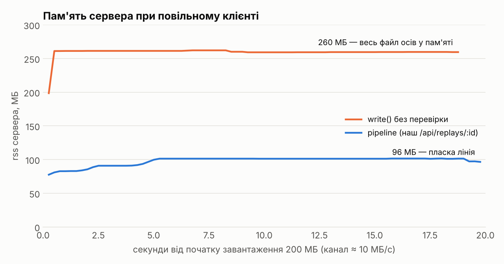

# Tank Arena — Lab 04

Лабораторна 04: **Node.js — EventEmitter, streams, WebSocket-сервер**.

Клієнт з лаб 1–3 тепер працює з власним сервером на Node: кімнати, вхід/вихід, чат, лог матчу в файл і повтор матчу потоком. Координати кораблів по мережі **ще не передаються** — це лаба 5; гра в кімнаті поки локальна, а склад гравців і чат уже справжні.

Попередні лаби: [lab-01](lab-01.md), [lab-02](lab-02.md), [lab-03](lab-03.md).

## Запуск

```bash
npm install
cp .env.example .env        # необов'язково: PORT, HOST, LOG_DIR…

# розробка: два процеси (Vite :5173 проксує /api, /health і /ws на сервер :3000)
npm run dev:server          # node --watch --env-file-if-exists=../.env
npm run dev:client          # відкрийте http://localhost:5173

# «продакшен»: сервер сам віддає зібраний client/dist
npm start                   # build + node src/index.js → http://127.0.0.1:3000
```

`npm test` (86 клієнтських + 72 серверних тести), `npm run lint`.

**Перевірка «два вікна»:** відкрийте сторінку у двох вікнах → в обох оберіть ту саму кімнату → обидва бачать імена одне одного в чаті; `Enter` — писати, `Esc` — вийти з поля, ще раз `Esc` — в лобі.

## Структура

```text
package.json              "workspaces": ["client", "server"], "type": "module"
client/                   Vite-застосунок лаб 1–3
  src/net/connection.js   обгортка WebSocket: dispatch за type, черга send, reconnect + backoff
  src/net/room-session.js join/чат поверх Connection
  src/chat-ui.js          DOM чату й списку гравців (лише textContent)
server/
  src/index.js            node:http + WebSocketServer, createApp(), graceful shutdown
  src/config.js           PORT, HOST, LOG_DIR… з process.env, перевірка при старті
  src/api.js, static.js   маршрути /api/*, /health; статика з MIME і захистом від ..
  src/rooms.js            class Room extends EventEmitter, RoomManager
  src/protocol.js         типи повідомлень, версія, validate(), коди закриття
  src/ws.js               життєвий цикл з'єднання, heartbeat, ліміти
  src/ratelimit.js        token bucket;   src/policy.js — політика повільного клієнта
  src/log/matchlog.js     Transform (подія → NDJSON) + pipeline у файл
  src/log/replay.js       async generator над createReadStream
  test/                   node:test: 72 тести (HTTP, WS, стріми, shutdown, конфіг)
  experiments/, tools/    досліди з цього README
```

## M1. HTTP-сервер і API

Чистий `node:http`, без фреймворку.

| Маршрут                                    | Що робить                                                                                                                |
| ------------------------------------------ | ------------------------------------------------------------------------------------------------------------------------ |
| `GET /health`                              | `{status, uptimeSec, rss, heapUsed, rooms, connections}`                                                                 |
| `GET /api/rooms`                           | список кімнат із **реальною** кількістю гравців                                                                          |
| `POST /api/rooms`                          | створити кімнату; тіло ≤ 4 КБ, `Content-Type: application/json`, перевірка полів (201 + `Location`, 400/413/415/422/429) |
| `GET /api/replays`, `GET /api/replays/:id` | список логів / потокове завантаження (M3)                                                                                |
| `GET /…`                                   | статика з `client/dist`                                                                                                  |

- **Статика:** MIME-типи за розширенням, `X-Content-Type-Options: nosniff`, `index.html` для `/`. Захист від path traversal у три шари: (1) відхиляємо сегмент `..` після `decodeURIComponent` (тож і `%2e%2e`, і `..\`), (2) після `join` перевіряємо префікс каталогу, (3) `realpath` — symlink не веде назовні. Сирий `req.url` не можна розбирати через `new URL()`: вона мовчки «схлопує» `/../`. Тест шле атаки сирим TCP-сокетом.
- **Конфіг:** `config.js` — єдине місце, де читається `process.env`. Усі помилки перелічуються разом (`PORT має бути цілим 0–65535, отримано "abc"`), процес виходить із кодом 2. У розробці — `node --env-file-if-exists=../.env`.
- **Vite проксує** `/api`, `/health` і `/ws` (з `ws: true`) на сервер (`client/vite.config.js`). Перевірено і браузером, і Node-клієнтом через `:5173`.
- **Graceful shutdown** (`SIGINT`/`SIGTERM`): `server.close()` (нових з'єднань немає) → усім сокетам `1001 going away` → дописати й закрити логи → після grace-періоду обірвати довгі HTTP-завантаження → `exit 0`. Тест запускає справжній процес, шле `SIGTERM` і перевіряє код 0, close-код 1001 клієнта та `match_end` в останньому рядку логу. Саме цей тест знайшов гонку: кімната спорожніла (і запустила `stop()` логу) _раніше_, ніж `closeAll()` почав чекати, тож процес виходив до дозапису хвоста.

## M2. Кімнати і WebSocket

**`Room extends EventEmitter`** не знає про сокети: гравець — це `{id, name, send()}`. Події: `open`, `join`, `leave`, `chat`, `event` (усе для логу), `empty`. `RoomManager` видаляє кімнату на `empty`; дефолтні кімнати (`training`, `belt`, `frontline`, `duel`) позначені `permanent` і не видаляються, щоб лобі не порожніло, — кімнати з `POST /api/rooms` видаляються. Ліміти: `MAX_ROOMS` (20), гравців у кімнаті (`maxPlayers` ≤ 8).

### Протокол v1 (JSON, `type`)

| Напрямок        | Повідомлення                                                                               |
| --------------- | ------------------------------------------------------------------------------------------ |
| клієнт → сервер | `{type:'join', v:1, room, name}` (перше), `{type:'chat', text ≤ 200}`, `{type:'leave'}`    |
| сервер → клієнт | `welcome {you, room}`, `roster {players}`, `chat {from, text, t}`, `error {code, message}` |

`validate()` перевіряє **кожне** повідомлення: розбір JSON, форма, довжини, керівні символи, версія; зайві поля відкидаються. Будь-яке порушення = `error` + закриття сокета з кодом (4000–4999 — діапазон застосунку за RFC 6455):

| Код  | Коли                                                          |
| ---- | ------------------------------------------------------------- |
| 1003 | бінарний кадр                                                 |
| 1009 | кадр більший за `maxPayload` (2 КБ; сама `ws`)                |
| 4000 | `join` не прийшов за 5 с                                      |
| 4001 | зламаний JSON/форма, повідомлення до `join`, повторний `join` |
| 4002 | невідомий `type`                                              |
| 4003 | кімнати немає / заповнена                                     |
| 4004 | перевищено ліміт повідомлень                                  |
| 4005 | повільний клієнт (M4)                                         |
| 4006 | непідтримувана версія протоколу                               |

- **Heartbeat:** один `setInterval` на сервер раз на 15 с шле `ping`; лічильник пропущених `pong` скидається на кожен `pong`; два пропущені поспіль → `terminate()`. Браузер відповідає на ping автоматично. Тест прискорює інтервал до 40 мс.
- **`"error"` слухач на кожному сокеті** ставиться першим рядком обробника `connection`; є тест, що емітить `error` на серверному сокеті, і процес живий. Те саме для `WebSocketServer`.
- **Клієнт:** `connection.js` — dispatch за `type` (`on('chat', …)`), черга `send()` (до відкриття і під час reconnect; ≤ 50, понад ліміт — відкидаємо), reconnect із backoff `500 мс·2ⁿ` до 15 с з jitter, `handshake()` (join) — завжди першим після кожного підключення, тож після обриву гравець повертається в кімнату сам. «Безнадійні» коди (4001–4006, 1003, 1009) не повторюються — гравець повертається в лобі з поясненням. 13 тестів на фейковому сокеті.
- **Лобі** (з лаби 3) далі опитує `GET /api/rooms`; тепер це справжній сервер, а `Join` відкриває сокет. Перевірено в Chromium (скриншоти в `docs/screenshots/lab4-*.png`): два вікна бачать roster і чат одне одного; перезапуск сервера → «зв'язок втрачено · спроба 1 через 0.3 с» → обидва повертаються в кімнату, відкладене повідомлення доставляється; відхилення «кімната заповнена» повертає в лобі з повідомленням.

## M3. Лог матчу як потоки

```text
події кімнати ─► Readable.from(events.on(room,'event')) ─► Transform (об'єкт → рядок NDJSON) ─► createWriteStream
                                  └──────────────── stream/promises.pipeline ────────────────────┘
```

- Матч починається, коли в кімнату заходить перший гравець (`open`), і закінчується на `empty`: `AbortController` зупиняє `events.on`, генератор дописує `match_end`, `pipeline` завершується, файл закрито. Файл: `LOG_DIR/<room>-<timestamp>.ndjson`.
- `replay.js` — async generator: `createReadStream` → склейка рядків (шматок може обірватись посеред рядка чи UTF-8 символу) → `JSON.parse`. Обрізаний хвіст після аварійної зупинки ігнорується, биті рядки в середині — `ReplayError` з номером рядка. Тест із рядками > 64 КБ і емодзі.
- `GET /api/replays/:id` — `pipeline(createReadStream(path), res)`: файл не читається в пам'ять; id перевіряється регулярним виразом `^[A-Za-z0-9_-]{1,128}$` (ніяких `/` і `..`).

### Backpressure-доказ: rss під час повільного завантаження 200 МБ

Синтетичний лог 200 МБ (`npm run tool:big-log -w server`), клієнт «повільного каналу» читає ≈ 10 МБ/с і ставить потік на паузу між шматками; кожні 250 мс беремо `rss` сервера з `/health`. Порівняння: наш сервер vs контрприклад, що в `data`-колбеку робить `res.write(chunk)` без перевірки результату.



|                         | rss на старті | пік    | приріст                      |
| ----------------------- | ------------- | ------ | ---------------------------- |
| `pipeline` (наш сервер) | 70 МБ         | 102 МБ | +31 МБ                       |
| `write()` без перевірки | 55 МБ         | 262 МБ | **+207 МБ** (≈ розмір файлу) |

Крива `pipeline` після прогріву (≈ 5 с: буфери сокета, JIT, пул `Buffer`) **пласка** на ≈ 100 МБ. Щоб переконатись, що це не збіг, прогнав 600 МБ на швидшому каналі — пік 106 МБ, тобто пам'ять **не залежить від розміру файлу** (`docs/rss-600mb-pipeline.csv`). Контрприклад за 2 с прочитав весь файл у пам'ять, бо диск швидший за мережу.

Чесне застереження: замість DevTools-throttling я використав повільний читач на Node. Механізм той самий — клієнт не забирає дані, TCP-вікно закривається, `res.write()` повертає `false`, `pipeline` ставить читання файлу на паузу до `drain`. Повторити: `npm run exp:rss -w server`, графік — `python3 server/tools/plot-rss.py`.

## M4. Захист від зловживань

- **Token bucket** на з'єднання: ємність і поповнення `RATE_LIMIT_PER_SEC` (за замовчуванням 20/с). Перевіряється **до** розбору JSON; вичерпано → `4004`. Годинник інжектується, тест не спить.
- `maxPayload` 2 КБ, `MAX_ROOMS`, `maxPlayers` на кімнату, тіло `POST` ≤ 4 КБ (перевіряється і по `Content-Length`, і по факту надходження чанків при `Transfer-Encoding: chunked`).
- **Повільний клієнт:** `socket.bufferedAmount` — байти, які ми віддали в `send()`, а ядро ще не відправило. `> 64 КБ` — некритичне (чат) пропускаємо (`stats.dropped`), `> 1 МБ` — закриваємо `4005`. Критичне (`welcome`, `roster`, `error`) йде, поки не досягнуто другого порога. Рішення винесене в чисту функцію `slowClientAction()` (юніт-тест), плюс інтеграційний тест, де клієнт ставить свій сокет на паузу.

## Цикл подій, backpressure, `error`

### Фази libuv

```text
┌─► timers (setTimeout/setInterval) ─► pending callbacks ─► poll (I/O: сокети, файли)
│                                                                    │
└── close callbacks ◄─ check (setImmediate) ◄────────────────────────┘
        між КОЖНИМ колбеком: process.nextTick → мікрозадачі (промiси, queueMicrotask)
```

Перевірка (`npm run exp:order -w server`, 12 запусків кожного):

| контекст                  | вивід                                             | стабільність                                                                                                         |
| ------------------------- | ------------------------------------------------- | -------------------------------------------------------------------------------------------------------------------- |
| CommonJS, головний модуль | `sync → nextTick → promise → immediate → timeout` | 10×; у 2 із 12 `timeout` і `immediate` помінялись місцями — залежить від того, чи минула 1 мс до входу в фазу timers |
| ESM, головний модуль      | `sync → promise → nextTick → immediate → timeout` | 12/12, але **promise раніше за nextTick**: ESM-модуль сам виконується всередині мікрозадачі                          |
| усередині I/O-колбека     | `nextTick → promise → immediate → timeout`        | 12/12: після poll завжди іде check (`setImmediate`), тому порядок детермінований                                     |

### Що буде, якщо обробник HTTP на 300 мс займе цикл подій

Node виконує наш JS в одному потоці: поки `/api/slow` крутить `while`-цикл (DEMO_ENDPOINTS=1), **жоден** інший колбек не виконується — ні нові запити, ні розсилка чату, ні pong, ні таймери. Досвід (`npm run exp:block -w server`; сервер — окремий процес, Alice шле чат раз на 50 мс, Bob міряє затримку):

```text
/api/slow відповів через 344 мс (busy-loop: 300 мс)
  відправлено, мс   затримка, мс
       533              2
       583            263   █████████████████████████████████
       636            210   ██████████████████████████
       687            160   ████████████████████
       737            109   ██████████████
       787             59   ███████
       846              0
звичайна затримка: ~0.8 мс, максимум під час блоку: 263 мс
```

Повідомлення, надіслані під час блоку, чекали в черзі ядра, а після нього розгрібалися пачкою — тому «сходи» затримок. Для гри з кроком 16 мс це 15+ пропущених тіків для **всіх** кімнат одразу. Лікування: не блокувати (стрімити, розбивати роботу `setImmediate`-ом, важке — у `worker_threads`). Те саме для `readFileSync`/`JSON.parse` великих файлів у обробнику.

### Чому `"error"` без слухача валить увесь процес

`EventEmitter.emit('error', err)` без слухача **кидає** `err` синхронно — і це `uncaughtException`, процес завершується (код 1). `ws` емітить `error` на сокеті при поганих кадрах, тож один клієнт міг би покласти всі кімнати. Справжній вивід (`npm run exp:crash -w server`; клієнт шле 2 КБ у сервер з `maxPayload: 1024`):

```text
=== emitter-bad: код виходу 1 ===
node:events:497
      throw er; // Unhandled 'error' event
RangeError: Max payload size exceeded
Emitted 'error' event on WebSocket instance at: …
  code: 'WS_ERR_UNSUPPORTED_MESSAGE_LENGTH'

=== emitter-fixed: код виходу 0 ===       ← socket.on('error', …) одним рядком
[ws] помилка сокета оброблено: Max payload size exceeded
[server] процес живий, сервер працює далі
```

Промісний аналог — `unhandledRejection` (з Node 15 теж валить процес): `socket.on('message', async () => { await … })` повертає проміс, який ніхто не чекає. Лікування — `try/catch` всередині обробника (`promise-fixed` у тому ж скрипті).

## Захист: Reflection (короткі відповіді)

1. **Фази циклу подій** — див. схему вище. `nextTick` і промісні реакції — між колбеками (черга `nextTick` раніше за мікрозадачі, окрім ESM-головного модуля), `setTimeout` — фаза timers, `setImmediate` — check після poll. З головного модуля порядок `setTimeout(0)`/`setImmediate` залежить від того, чи встиг пройти 1 мс до входу в цикл; у I/O-колбеку після poll завжди йде check.
2. **Файли без блокування:** файлові операції `fs` (і DNS lookup, crypto, zlib) виконує **thread pool libuv** (4 потоки за замовчуванням), JS-потік лише отримує колбек. Мережеві сокети в пул не йдуть — вони на epoll/kqueue/IOCP.
3. **CommonJS vs ESM:** `require` синхронний, `import` асинхронний і статично аналізований; `module.exports` vs іменовані експорти (живі прив'язки); `this` на верхньому рівні, `__dirname` відсутній в ESM (замість нього `import.meta.dirname` / `fileURLToPath(import.meta.url)`); top-level `await` лише в ESM.
4. **Backpressure:** `write()` повертає `false`, коли внутрішній буфер перевищив `highWaterMark`; продюсер має почекати `drain`. Якщо ігнорувати — дані копляться в пам'яті (графік вище). `pipeline` робить це сам, а ще пробрасує помилки й закриває всі ланки.
5. **Readable / Writable / Duplex / Transform:** джерело / приймач / обидва напрямки незалежно / Duplex, де вихід обчислюється з входу. TCP-сокет — **Duplex**.
6. **Рукостискання WebSocket:** HTTP `GET` з `Upgrade: websocket`, `Sec-WebSocket-Key`; сервер відповідає `101 Switching Protocols` і `Sec-WebSocket-Accept` (SHA-1 від ключа + GUID); далі той самий TCP-сокет — двонапрямні кадри. Проти polling — немає накладних заголовків на кожне повідомлення й затримки опитування; проти SSE — клієнт теж може слати.
7. **Чому `error` треба слухати:** див. розділ вище. Промісний еквівалент — `unhandledRejection` (обробляти `catch`, а не покладатися на `process.on`).
8. **2G і 30 знімків/с:** повідомлення копляться в `bufferedAmount` → пам'ять сервера росте на кожного такого клієнта. Виявляємо через `bufferedAmount`, лікуємо: пропускати застарілі знімки (лишати лише останній), знижувати частоту, закривати сокет — реалізовано в `policy.js`.
9. **Чому валідувати власного клієнта:** клієнт — це чужий код у чужому браузері: його можна підмінити (`wscat`, DevTools), він може бути старої версії, а з мережі прийде що завгодно. Сервер — єдина межа довіри.

## Теги

Тег: `lab-04`.
